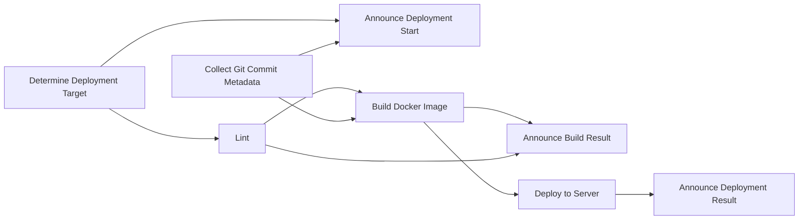
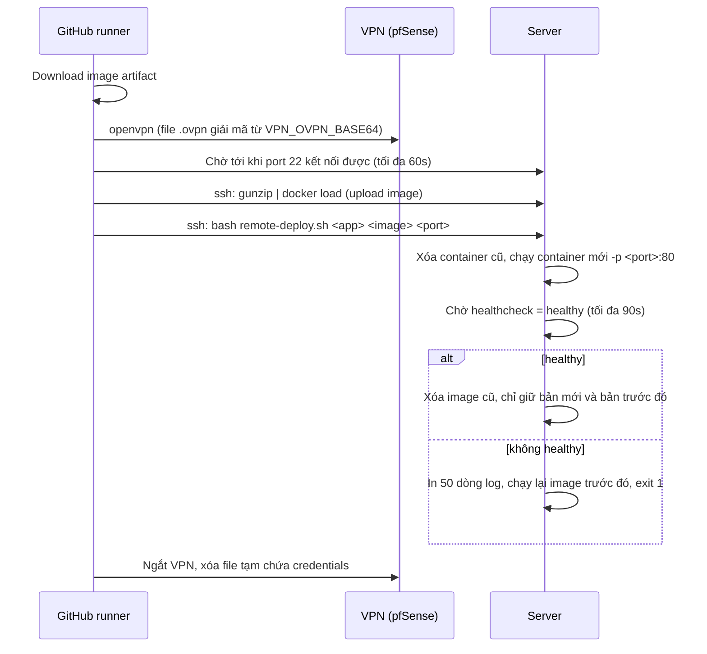

# CI/CD: build và deploy

Tài liệu này mô tả pipeline tự động build và deploy frontend `ai-agent-sso-cms` lên server bằng GitHub Actions và Docker.

## Cấu trúc file

```
.
├── .github/
│   ├── workflows/
│   │   └── deploy.yml              # Workflow chính: các job từ lint đến deploy
│   └── scripts/
│       └── telegram-notify.sh      # Gửi thông báo Telegram, không bao giờ làm fail pipeline
├── dev-ops/
│   ├── deploy/
│   │   ├── ssh-cmd.sh              # Dựng lệnh SSH (mật khẩu hoặc key), dùng trong job Deploy
│   │   └── remote-deploy.sh        # Chạy TRÊN SERVER: thay container, healthcheck, rollback
│   ├── docker/
│   │   └── nginx.conf              # Cấu hình nginx bên trong image (SPA fallback, cache)
│   └── env/
│       └── production.env.example  # Mẫu file env production (dán vào secret APP_ENV_FILE)
├── source/
│   ├── .nvmrc                      # Phiên bản Node dùng để build (hiện tại: 18)
│   └── env/.dev                    # File env của môi trường dev (đã commit)
├── Dockerfile                      # Multi-stage: build bằng Node, chạy bằng nginx
├── .dockerignore                   # Loại node_modules, build, .git, *.ovpn... khỏi build context
└── .gitattributes                  # Bắt buộc LF cho *.sh, Dockerfile, *.conf, *.yml
```

## Khi nào pipeline chạy

| Sự kiện | GitHub Environment | File env khi build | Container trên server |
|---|---|---|---|
| Push hoặc merge PR vào `dev` | `dev` | `source/env/.dev` | `ai-agent-sso-cms-dev` |
| Push hoặc merge PR vào `main` | `prod` | `source/env/.production`, ghi ra từ secret `APP_ENV_FILE` | `ai-agent-sso-cms-prod` |
| Bấm **Run workflow** trên tab Actions | chọn `dev` hoặc `prod` | như trên | như trên |

Mỗi environment chỉ chạy một deploy tại một thời điểm. Nếu có push mới khi đang deploy, lần chạy mới sẽ đợi lần cũ xong chứ không hủy nó.

## Luồng các job



| # | Job | Việc làm | Nếu lỗi |
|---|---|---|---|
| 1 | **Determine Deployment Target** | Xác định environment (`dev`/`prod`) từ nhánh hoặc input, đọc phiên bản Node từ `source/.nvmrc` | Dừng toàn bộ pipeline |
| 2 | **Collect Git Commit Metadata** | Lấy SHA ngắn và message của commit để gắn vào tag image và thông báo | Dừng toàn bộ pipeline |
| 3 | **Announce Deployment Start** | Gửi Telegram `🚀 Build & deploy started [env]` | Không ảnh hưởng các job khác |
| 4 | **Lint** | `npm ci`, rồi `eslint --quiet`: chỉ chặn khi có **error**, bỏ qua warning | Không build, không deploy |
| 5 | **Build Docker Image** | Chạy trong environment. Đọc biến `APP_NAME`/`APP_PORT`/`BUILD_ENV`, chuẩn bị file env, `docker build`, lưu image thành artifact `docker-image-<env>` (giữ 1 ngày) | Không deploy |
| 6 | **Announce Build Result** | Gửi `✅ Build succeeded` (kèm tên image, Node, file env) hoặc `❌ Build failed` (kèm kết quả Lint và Build) | Không ảnh hưởng |
| 7 | **Deploy to Server** | Chạy trong environment. Các bước: tải artifact, kết nối VPN, setup SSH, upload image, start container, ngắt VPN | Server giữ nguyên container cũ (xem phần Rollback) |
| 8 | **Announce Deployment Result** | Gửi `✅ Deploy & start succeeded` (kèm container và port) hoặc `❌ Deploy failed`. Chỉ chạy khi build đã thành công | Không ảnh hưởng |

### Chi tiết job Build Docker Image

1. **Resolve app config**: lấy Environment variables. Nếu không đặt thì dùng mặc định: `APP_NAME = ai-agent-sso-cms-<env>`, `APP_PORT = 3000`, `BUILD_ENV = dev` (hoặc `production` với prod).
2. **Prepare app env file**: nếu environment có secret `APP_ENV_FILE`, ghi nội dung đó ra `source/env/.<BUILD_ENV>`. Nếu không có, dùng file đã commit. Nếu file cũng không tồn tại, job báo lỗi.
3. **Docker build**: `Dockerfile` gồm 2 stage:
   - `node:<.nvmrc>-alpine`: `npm ci`, rồi `npm run build:<BUILD_ENV>`.
   - `nginx:1.27-alpine`: copy thư mục `build/` vào, phục vụ ở port 80, có `HEALTHCHECK`.
4. **Export image** và **Upload image artifact**: `docker save | gzip`, sau đó tải lên artifact để job Deploy dùng. Không cần Docker registry.

Image được đặt tag là `<APP_NAME>:<sha 7 ký tự>`, ví dụ `ai-agent-sso-cms-dev:1468e7b`.

### Chi tiết job Deploy to Server



SSH ưu tiên dùng `SSH_PRIVATE_KEY` nếu có, không thì dùng `SSH_PASSWORD` qua `sshpass`. Nếu có `SSH_KNOWN_HOSTS`, host key được kiểm tra chặt (`StrictHostKeyChecking=yes`).

### Rollback

`remote-deploy.sh` ghi nhớ image của container đang chạy trước khi thay. Nếu container mới không lên `healthy` trong 90 giây, script chạy lại image cũ và trả lỗi. Pipeline khi đó báo `❌ Deploy failed`, còn server vẫn chạy bản trước.

Server chỉ giữ 2 image cho mỗi app: bản vừa deploy và bản chạy ngay trước đó, các tag khác bị xóa. Muốn quay về bản trước thì chạy tay:

```bash
docker images ai-agent-sso-cms-dev
bash remote-deploy.sh ai-agent-sso-cms-dev ai-agent-sso-cms-dev:<sha-cũ> 3000
```

## Thông báo Telegram

Mọi tin nhắn có chung định dạng:

```
✅ Build succeeded [dev]
Repo: cong09112003/ai-agent-sso-cms
Branch: dev
Commit: 1468e7b - <commit message>
By: <github user>
Image: ai-agent-sso-cms-dev:1468e7b (Node 18, env .dev)
Run: https://github.com/.../actions/runs/<id>
```

| Thời điểm | Tin nhắn |
|---|---|
| Bắt đầu | `🚀 Build & deploy started [env]` |
| Build xong | `✅ Build succeeded [env]` / `❌ Build failed [env]` |
| Deploy xong | `✅ Deploy & start succeeded [env]` / `❌ Deploy failed [env]` |

Nếu thiếu secret `TELEGRAM_*` hoặc Telegram không phản hồi, script chỉ ghi log rồi bỏ qua, pipeline vẫn chạy tiếp.

## Cấu hình trên GitHub

Đường dẫn: **Settings → Secrets and variables → Actions** và **Settings → Environments**.

| Loại | Tên | Bắt buộc | Ghi chú |
|---|---|---|---|
| Repository secret | `TELEGRAM_BOT_TOKEN` | Có | Dùng chung cho mọi environment |
| Repository secret | `TELEGRAM_CHAT_ID` | Có | ID group, có dấu `-` ở đầu |
| Environment secret | `VPN_OVPN_BASE64` | Có | `base64 -w0 client.ovpn` |
| Environment secret | `OVPN_USERNAME`, `OVPN_PASSWORD` | Không | Chỉ cần nếu VPN dùng `auth-user-pass` |
| Environment secret | `SSH_HOST`, `SSH_USER` | Có | |
| Environment secret | `SSH_PASSWORD` hoặc `SSH_PRIVATE_KEY` | Có (một trong hai) | Nên dùng key |
| Environment secret | `SSH_KNOWN_HOSTS` | Không | Kết quả của `ssh-keyscan <host>` |
| Environment secret | `APP_ENV_FILE` | Có với `prod` | Nội dung file env, theo mẫu `dev-ops/env/production.env.example` |
| Environment variable | `APP_PORT`, `APP_NAME`, `BUILD_ENV` | Không | Nếu dev và prod chạy chung server, phải đặt `APP_PORT` khác nhau |

Job Build và job Deploy đều gắn với environment. Vì vậy nếu `prod` bật **Required reviewers**, mỗi lần deploy prod phải duyệt 2 lần.

## Nhiều frontend, nhiều phiên bản Node

Server chỉ cần Docker. Mỗi frontend tự quyết phiên bản Node trong image của nó, nên các app không ảnh hưởng nhau. Để thêm một frontend khác:

1. Copy `Dockerfile`, `.dockerignore`, `dev-ops/` và `.github/` sang repo mới.
2. Đặt phiên bản Node trong `source/.nvmrc` của repo đó.
3. Chọn `APP_NAME` và `APP_PORT` riêng, không trùng với app khác trên server.

Xem các app đang chạy: `docker ps --filter label=fe-app`.

## Xử lý sự cố

| Triệu chứng | Kiểm tra |
|---|---|
| Lint fail | Chạy `npx eslint "src/**/*.js" --quiet` trong `source/` |
| `source/env/.production not found` | Environment `prod` thiếu secret `APP_ENV_FILE` |
| `Missing VPN_OVPN_BASE64 or SSH_HOST` | Secret chưa được tạo trong đúng environment |
| `Cannot reach the server on port 22` | File `.ovpn` sai hoặc hết hạn, VPN cần user/pass, hoặc `SSH_HOST` sai |
| `Permission denied` khi SSH | Sai `SSH_USER`/`SSH_PASSWORD`, hoặc server tắt đăng nhập bằng mật khẩu |
| `did not become healthy` | Xem log job Deploy (có 50 dòng log container), hoặc chạy `docker logs <APP_NAME>` trên server |
| Không có tin nhắn Telegram | Kiểm tra `TELEGRAM_*` và bot đã được thêm vào group chưa |
